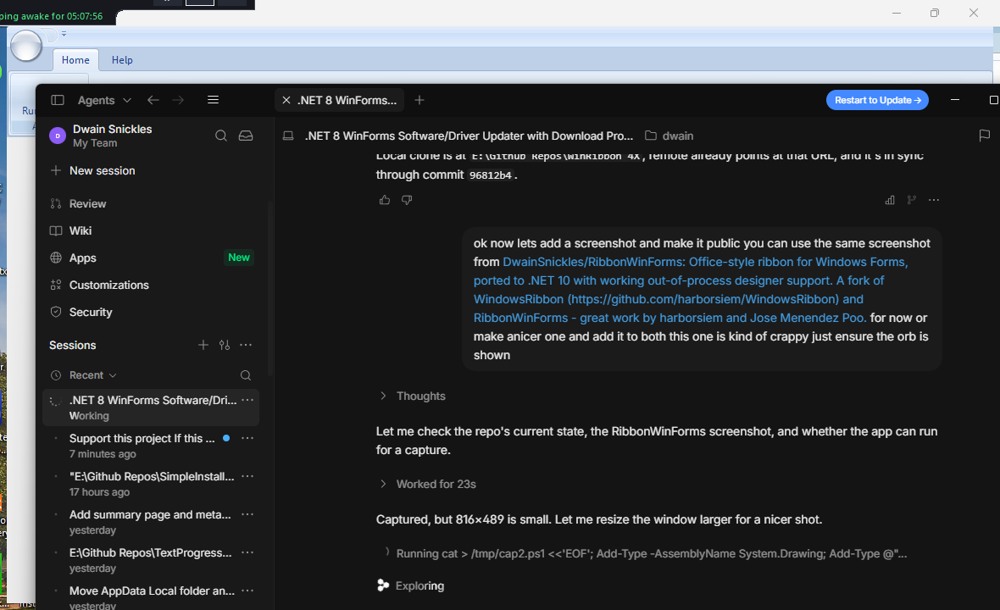

# WinRibbon for .NET Framework 4.x

> **Using .NET 8, .NET 10, or newer?** The same ribbon lives in [DwainSnickles/RibbonWinForms](https://github.com/DwainSnickles/RibbonWinForms) with the modern out-of-process designer and NuGet packages. This repo is the .NET Framework 4.x edition.

A WinForms ribbon control for **.NET Framework 4.8**, with full Visual Studio designer support via the legacy in-process designer.

## Projects

| Project | What it is |
|---|---|
| `WinRibbon` | The ribbon control (`WinRibbon.dll`, targets `net48`) |
| `WinRibbon.Design` | Legacy designer support — builds as `RibbonLib.Design.dll` because the control's `[Designer]`/`[Editor]` attributes resolve that assembly name |
| `WinRibbon 4X` | Sample WinForms app showing the ribbon on a form |

## Designer support

`RibbonLib.Design.dll` **must** sit next to `WinRibbon.dll` in the output folder — the control's designer attributes point at that assembly name. Reference both projects (or both DLLs) and the ribbon drops onto the form surface with editable tabs, panels, buttons, and collection editors.

## Requirements

- .NET Framework 4.8
- Visual Studio with .NET Framework targeting pack

## License

Ms-PL — see [LICENSE](LICENSE). Based on [RibbonWinForms/RibbonWinForms](https://github.com/RibbonWinForms/RibbonWinForms) by Jose Menendez Poo.

## Support this project

If this project saved you some time, you can leave a tip at [ko-fi.com/dwainhsnickles](https://ko-fi.com/dwainhsnickles) (cards, no account needed) or [paypal.me/YTDPlatinum](https://paypal.me/YTDPlatinum). Bug reports and pull requests are welcome too.

The .NET 8/10 edition is at [DwainSnickles/RibbonWinForms](https://github.com/DwainSnickles/RibbonWinForms).
